# MiniPi 2.0 — A Better, More Detailed Build Plan

Yes. The previous plan was a good skeleton, but it can be made substantially stronger by keeping Pi’s **minimal core** while adding the missing production layers: reliable tool execution, safe permissions, evaluation, cost control, context management, observability, recovery, and packaging. Pi itself stays deliberately small—an extensible terminal agent that inspects files, runs commands, edits content, and works through multi-step tasks—while its SDK separates the agent core from the interface, sessions, tools, models, and resources.

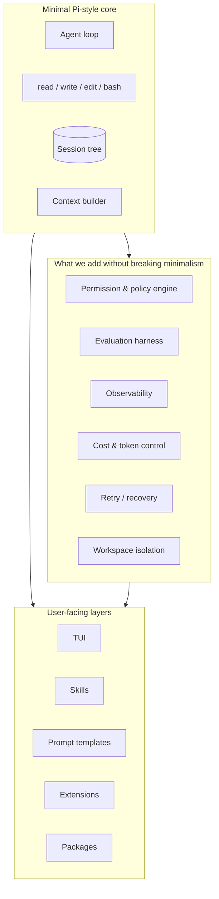

## 1. Design Principle: Minimal Core, Strong Boundaries

Do **not** add more built-in LLM tools. Keep the core at:

- `read`
- `write`
- `edit`
- `bash`

Everything else should be a **boundary**, **extension**, or **resource**:

| Concern                    | Correct place               |
| -------------------------- | --------------------------- |
| File access rules          | Policy engine               |
| Dangerous command approval | Extension / permission gate |
| Project conventions        | `AGENTS.md`               |
| Repeatable workflow        | Skill                       |
| Reusable prompt            | Prompt template             |
| Custom integration         | Extension                   |
| Model access               | Provider adapter            |
| Session history            | Session manager             |
| UI                         | TUI layer                   |

This mirrors Pi’s architecture: a session owns the conversation, model, tools, queued messages, compaction state, and extension runtime; the host can replace model runtime, settings, session manager, resource loader, and active tools.

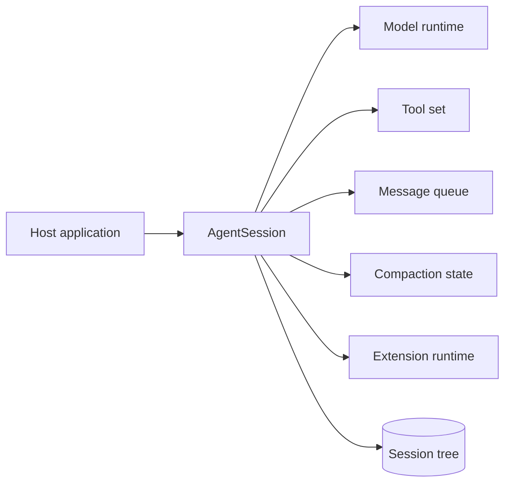

## 2. Limitations of the First Plan

| Limitation                    | Risk                            | MiniPi 2.0 solution                                 |
| ----------------------------- | ------------------------------- | --------------------------------------------------- |
| Agent repeats failed actions  | Wasted tokens, infinite loops   | Turn budget, failure memory, retry policy           |
| Tool output floods context    | Context overflow, high cost     | Output truncation, artifact files, selective reload |
| Model edits wrong file        | Data loss                       | Path policy, diff preview, backup/checkpoint        |
| `bash` is unsafe            | Destructive commands            | Command classifier, allow/deny/confirm policy       |
| No way to know if agent works | Silent quality regressions      | Task-based evaluation suite                         |
| Session grows forever         | Cost and context limits         | Tiered compaction and artifact store                |
| Extensions are too powerful   | Credential/file/system exposure | Capability-based extension permissions              |
| No cost visibility            | Surprise API bills              | Token/cost meter per turn and session               |
| No recovery after crash       | Lost work                       | Append-only JSONL plus checkpoint events            |
| UI and core are tangled       | Hard to test or embed           | Event-driven core, pluggable TUI                    |

Pi’s documentation is explicit that project trust controls which project resources load, but it does **not** sandbox tool calls; tools and extensions run with the permissions of the Pi process.  Therefore, MiniPi 2.0 must treat safety as an architectural boundary, not a prompt instruction.

## 3. Revised Architecture

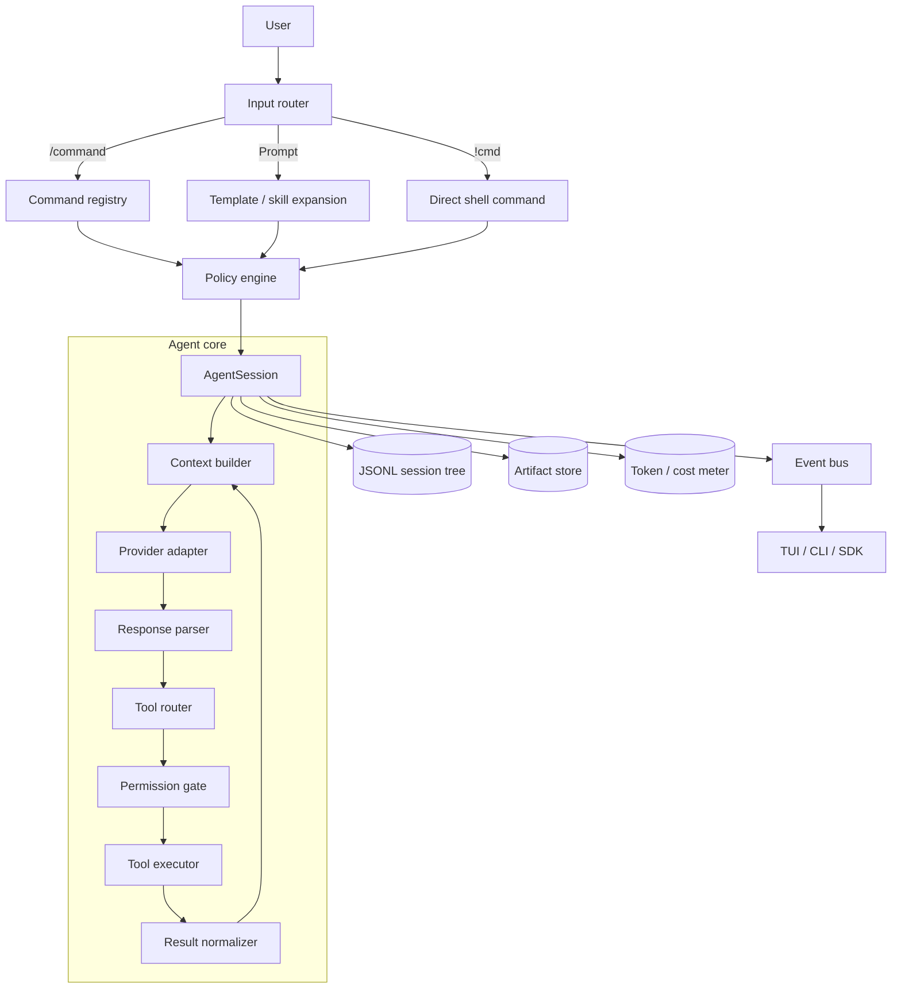

### Core components

| Component           | Responsibility                                                        |
| ------------------- | --------------------------------------------------------------------- |
| `InputRouter`     | Distinguish prompts, slash commands, shell commands, queued messages  |
| `ContextBuilder`  | Base prompt, global/project`AGENTS.md`, skills, extensions, history |
| `ProviderAdapter` | Normalize Anthropic/OpenAI/local models into one interface            |
| `ToolRegistry`    | Validate and execute the four core tools                              |
| `PolicyEngine`    | Paths, commands, approvals, audit decisions                           |
| `SessionManager`  | Append-only JSONL, branching, active leaf, restore                    |
| `ArtifactStore`   | Large outputs saved outside model context                             |
| `Compactor`       | Summarize old turns while preserving decisions and state              |
| `EventBus`        | Stream lifecycle events to any UI                                     |
| `Evaluator`       | Run repeatable tasks and score outcomes                               |

Pi’s SDK exposes exactly this kind of separation: `session.prompt()` handles extension commands and template expansion; sessions support steering and follow-up messages; events report message updates, tool execution, queues, compaction, retries, and lifecycle changes.

## 4. The Improved Agent Loop

The original loop was:

1. Send context.
2. Get response.
3. Run tools.
4. Repeat.

MiniPi 2.0 adds **verification, recovery, budgeting, and event emission**.

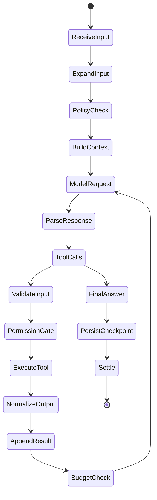

### Python loop improvements

```python
# src/mini_pi/agent/loop.py
from dataclasses import dataclass, field
from typing import Callable

from mini_pi.agent.types import Message, ToolUseBlock
from mini_pi.providers.base import ModelClient
from mini_pi.tools.registry import ToolContext, ToolRegistry


@dataclass
class RunBudget:
    max_turns: int = 30
    max_tool_calls: int = 80
    max_total_tokens: int = 400_000
    max_cost_usd: float = 5.0
    max_consecutive_failures: int = 3


@dataclass
class RunState:
    turns: int = 0
    tool_calls: int = 0
    total_tokens: int = 0
    cost_usd: float = 0.0
    consecutive_failures: int = 0
    failed_tools: dict[str, int] = field(default_factory=dict)


class AgentLoop:
    def __init__(
        self,
        model: ModelClient,
        tools: ToolRegistry,
        system_prompt: str,
        cwd: str,
        budget: RunBudget | None = None,
        on_event: Callable[[dict], None] | None = None,
    ) -> None:
        self.model = model
        self.tools = tools
        self.system_prompt = system_prompt
        self.cwd = cwd
        self.budget = budget or RunBudget()
        self.on_event = on_event or (lambda event: None)

    async def run(self, history: list[Message], user_text: str) -> list[Message]:
        state = RunState()
        history.append(self._user_message(user_text))

        self._emit("agent_start", {"goal": user_text})

        while state.turns < self.budget.max_turns:
            state.turns += 1
            self._emit("turn_start", {"turn": state.turns})

            response = await self.model.complete(
                system=self.system_prompt,
                messages=history,
                tools=self.tools.schemas(),
            )

            history.append(response.message)
            state.total_tokens += response.input_tokens + response.output_tokens
            state.cost_usd += response.cost_usd

            self._emit(
                "message_end",
                {
                    "message": response.message.model_dump(),
                    "tokens": state.total_tokens,
                    "cost_usd": state.cost_usd,
                },
            )

            calls = [
                block
                for block in response.message.content
                if isinstance(block, ToolUseBlock)
            ]

            if not calls:
                self._emit("agent_end", {"reason": "final_response"})
                return history

            for call in calls:
                state.tool_calls += 1

                if state.tool_calls > self.budget.max_tool_calls:
                    raise RuntimeError("Tool-call budget exceeded")

                result = await self._execute(call, state)
                history.append(result)

            if state.consecutive_failures >= self.budget.max_consecutive_failures:
                raise RuntimeError(
                    "Agent stopped after repeated tool failures"
                )

        raise RuntimeError("Turn budget exceeded")

    async def _execute_tool(self, call, state):
        ...
```

### Failure memory

When a tool fails, do not merely return “error.” Return a structured, actionable observation:

```text
TOOL: edit
STATUS: failed
REASON: old_text not found
FILE: src/app.py
HINT: Read the file again and copy the exact text, including indentation.
NEXT ACTION: Use read before retrying edit.
```

This prevents the most common agent failure mode: repeatedly retrying the same bad edit.

## 5. Tool Layer: Still Four Tools, But Production-Grade

Keep only four built-ins, but make each one predictable.

| Tool      | Minimal version   | MiniPi 2.0 improvement                                                         |
| --------- | ----------------- | ------------------------------------------------------------------------------ |
| `read`  | Returns file text | Line numbers, file-size guard, binary detection, offset/limit                  |
| `write` | Writes a file     | Path policy, parent-directory rule, overwrite confirmation, backup             |
| `edit`  | Exact replacement | Unique-match enforcement, diff preview, atomic write, backup                   |
| `bash`  | Runs command      | Timeout, output cap, working-directory lock, command policy, exit-code capture |

### Tool execution pipeline

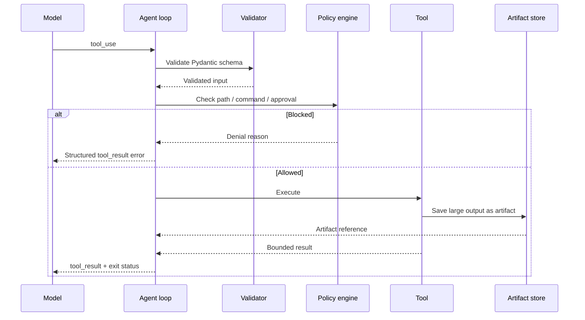

### Output discipline

Never place a 200,000-character test log directly into model context.

```python
MAX_INLINE_OUTPUT = 12_000

def normalize_tool_output(output: str, artifact_path: str | None) -> str:
    if len(output) <= MAX_INLINE_OUTPUT:
        return output

    return (
        f"{output[:MAX_INLINE_OUTPUT]}\n\n"
        f"[OUTPUT TRUNCATED]\n"
        f"Full output saved to: {artifact_path}\n"
        "Use read with offset/limit to inspect relevant sections."
    )
```

Large outputs go to `.mini-pi/artifacts/`, while the model receives a bounded summary plus a reference. This is essential because Pi sessions can include many file reads, command outputs, and edits; compaction exists precisely because raw history grows quickly.

## 6. Policy Engine: The Biggest Upgrade

Pi leaves tool calls unsandboxed by default, so MiniPi should add a policy layer around the same minimal tools.

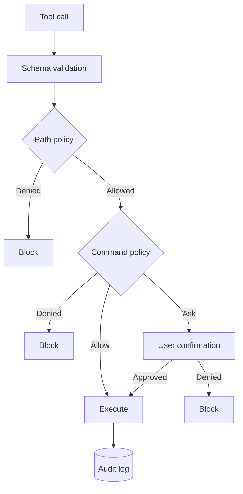

### Policy levels

| Level       | Behavior                          |
| ----------- | --------------------------------- |
| `allow`   | Run automatically                 |
| `confirm` | Ask the user                      |
| `deny`    | Block and explain                 |
| `audit`   | Run, but record detailed evidence |

### Protected paths

```python
PROTECTED_PATTERNS = [
    ".env",
    ".git/",
    "node_modules/",
    "__pycache__/",
    "*.pem",
    "*.key",
    "id_rsa",
    ".aws/",
    ".ssh/",
]
```

### Dangerous command classes

| Class                | Examples                                                   | Default         |
| -------------------- | ---------------------------------------------------------- | --------------- |
| Read-only            | `ls`, `cat`, `git status`, `pytest --collect-only` | Allow           |
| Build/test           | `pytest`, `ruff`, `mypy`, `npm test`               | Allow           |
| Network              | `pip install`, `curl`, `git pull`                    | Confirm         |
| Mutating Git         | `git commit`, `git push`                               | Confirm         |
| Destructive          | `rm -rf`, `git reset --hard`, `chmod -R 777`         | Deny or confirm |
| Privilege escalation | `sudo`, `doas`                                         | Deny by default |

### Audit record

```json
{
  "timestamp": "2026-10-29T09:04:11Z",
  "tool": "bash",
  "input": {"command": "rm -rf build"},
  "decision": "confirm",
  "user_decision": "denied",
  "reason": "destructive command",
  "session_id": "sess_123",
  "turn": 7
}
```

## 7. Sessions: Branching, Recovery, and Artifacts

Pi sessions are persistent by default; its `SessionManager` owns the entry tree and active leaf, and branching changes the leaf without deleting abandoned branches.

### Session file format

Use JSONL, but store more than raw messages:

```json
{"type":"session_start","session_id":"sess_123","cwd":"/project","created_at":"..."}
{"type":"message","id":"m1","parent_id":null,"role":"user","content":[...]}
{"type":"message","id":"m2","parent_id":"m1","role":"assistant","content":[...]}
{"type":"tool_call","id":"t1","message_id":"m2","tool":"read","input":{...}}
{"type":"tool_result","id":"r1","tool_call_id":"t1","status":"ok","artifact":"artifacts/test-log.txt"}
{"type":"checkpoint","id":"c1","message_id":"m2","git_sha":"abc123","description":"Before refactor"}
{"type":"compaction","id":"comp_1","replaces":["m1","m2"],"summary_id":"sum_1"}
```

### Session tree

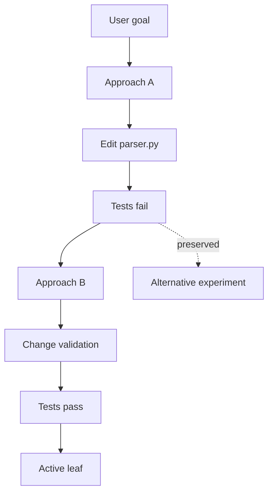

### Recovery

On restart:

1. Load JSONL entries.
2. Rebuild the tree.
3. Select the active leaf.
4. Replay only finalized messages into model context.
5. Mark incomplete tool calls as `interrupted`.
6. Ask the user whether to resume, retry, or branch.

This avoids the common bug where a crash leaves a tool call without a result and the model context becomes invalid.

## 8. Context Engineering

Pi keeps its base system prompt intentionally small and layers project instructions, tools, history, and skill or extension instructions into the effective context.

### Context priority

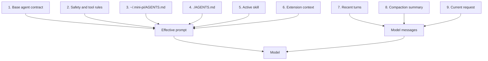

### Context budget

| Zone                     | Target share |
| ------------------------ | ------------ |
| System prompt and safety | 5–10%       |
| Project instructions     | 5–10%       |
| Active skill             | 5–15%       |
| Recent conversation      | 30–50%      |
| Compacted summary        | 10–25%      |
| Reserve for tool output  | 15–25%      |

### What compaction must preserve

| Preserve verbatim or explicitly | Compress                        |
| ------------------------------- | ------------------------------- |
| User goal and success criteria  | Old file contents               |
| Files changed and why           | Repeated failed command output  |
| Current branch and approach     | Resolved stack traces           |
| Outstanding blockers            | Exploratory dead ends           |
| Commands that work              | Verbose logs already summarized |
| Test status                     | Repeated identical tool results |

## 9. Extensions: Capabilities, Not Unlimited Power

Pi extensions can register tools, subscribe to lifecycle events, add commands, customize UI, connect providers, and integrate MCP servers.  But an extension should not automatically receive every capability.

### Capability model

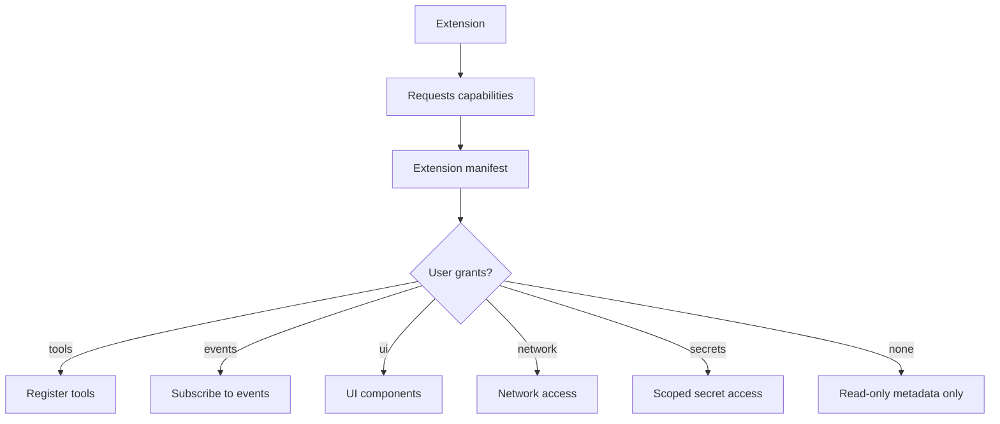

### Manifest example

```json
{
  "name": "safety-gate",
  "version": "0.1.0",
  "capabilities": ["events:tool_call", "ui:confirm"],
  "permissions": {
    "filesystem": "none",
    "network": "none",
    "secrets": "none"
  }
}
```

### Extension events

| Event                                    | Extension can                           |
| ---------------------------------------- | --------------------------------------- |
| `input`                                | Transform, redirect, or consume input   |
| `before_agent_start`                   | Modify effective prompt, tools, context |
| `agent_start` / `agent_end`          | Observe run lifecycle                   |
| `tool_call`                            | Validate, mutate, approve, or block     |
| `tool_result`                          | Redact, annotate, or summarize          |
| `session_before_compact`               | Replace or cancel compaction            |
| `session_start` / `session_shutdown` | Initialize or clean up resources        |

Pi’s real extension model supports tool registration, lifecycle events, commands, UI, providers, and MCP integration; its SDK also distinguishes replaceable built-ins such as `codemode`, `tool_search`, and MCP.

## 10. Skills and Templates

### Skill structure

```text
~/.mini-pi/skills/release/
├── SKILL.md
├── manifest.json
├── scripts/
│   └── check_release.py
└── references/
    └── checklist.md
```

`manifest.json`:

```json
{
  "name": "release",
  "description": "Prepare, verify, and document a production release.",
  "triggers": ["/skill:release"],
  "required_tools": ["read", "bash", "edit"],
  "approval_gates": ["git tag", "git push"]
}
```

### Progressive disclosure

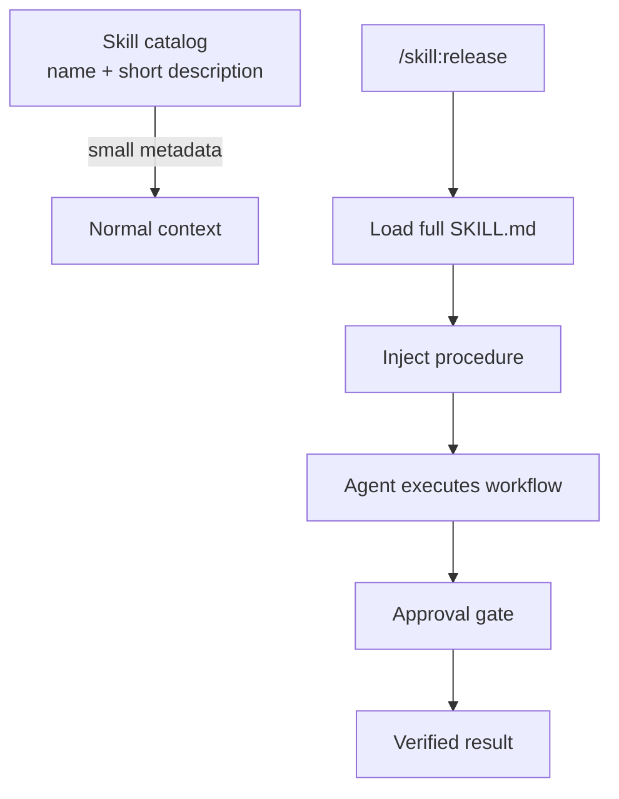

Only the skill description should remain in normal context; the full instructions load when invoked. This keeps context small while enabling detailed procedures.

## 11. Evaluation: The Missing Layer

An agent without evaluation is a demo. Add a task suite from day one.

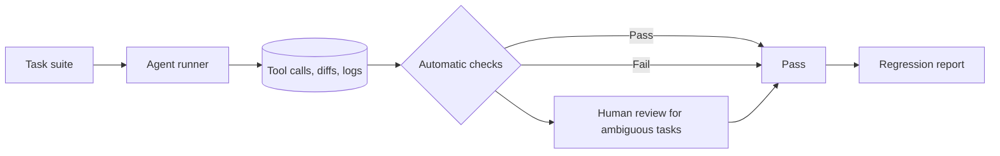

### Example evaluation cases

| Task                                              | Automatic check                                             |
| ------------------------------------------------- | ----------------------------------------------------------- |
| “Fix the failing test in`tests/test_math.py`” | `pytest` exits 0; intended test still exists              |
| “Add a`/health` route”                        | HTTP 200 response; no unrelated files changed               |
| “Refactor`utils.py` without behavior change”  | Tests pass; public API unchanged                            |
| “Find security issues in auth flow”             | Report contains expected issue classes; no false file edits |
| “Summarize repository”                          | Summary mentions required modules; no tool errors           |

### Evaluation metrics

| Metric              | Meaning                                |
| ------------------- | -------------------------------------- |
| Task success rate   | Percentage of tasks fully completed    |
| Tool accuracy       | Correct tool chosen for the step       |
| Edit precision      | Correct file and minimal diff          |
| Recovery rate       | Failures corrected without user help   |
| Token cost per task | Cost efficiency                        |
| Turns per task      | Agent efficiency                       |
| Unsafe action rate  | Blocked or dangerous calls             |
| Regression rate     | Previously passing tasks that now fail |

## 12. Observability and Cost Control

Every run should produce a trace:

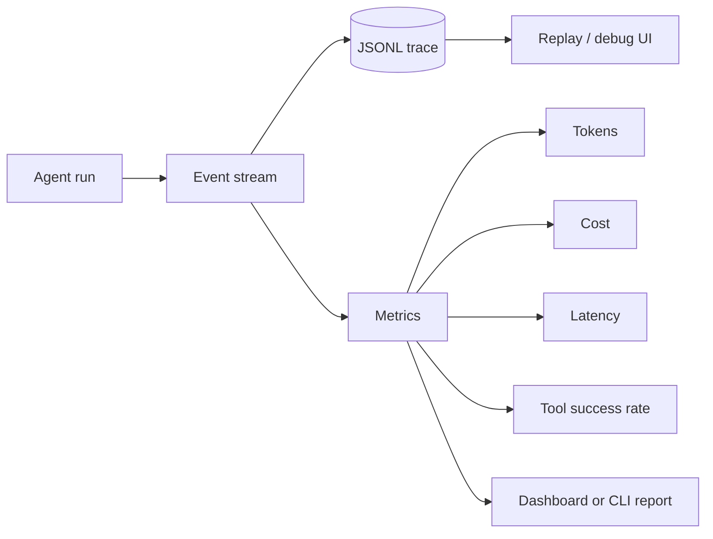

### Minimum metrics

- Input and output tokens per turn.
- Cost per turn, task, session, model, and extension.
- Tool-call count and success rate.
- Time to first token and total run duration.
- Compaction frequency and size reduction.
- Permission prompts and denials.
- Retry and recovery outcomes.

Pi’s event model already distinguishes message updates, tool execution, queues, compaction, retries, and run lifecycle events; `agent_settled` indicates that Pi will not continue automatically.  MiniPi should reuse that event taxonomy.

## 13. TUI: Small, Fast, Useful

Do not build a giant IDE. Build a terminal interface that makes the agent’s behavior legible.

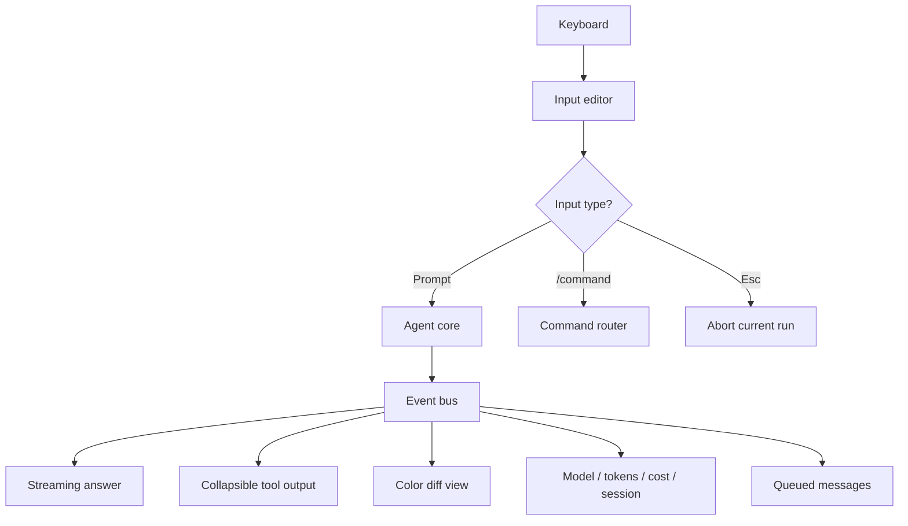

### Must-have TUI features

- Streaming assistant output.
- Collapsible tool calls and outputs.
- Colorized diffs for `write` and `edit`.
- Model, token, cost, and session status.
- `/tree`, `/fork`, `/resume`, `/compact`, `/reload`.
- Esc to abort; second interrupt to quit.
- Queued-message indicator.
- Clear permission dialog.
- Error surface that distinguishes model, tool, policy, and network failures.

## 14. Packaging and Distribution

Pi supports distributing extensions, skills, prompt templates, and themes as packages.  MiniPi should do the same, but with signed or reviewed packages and explicit capability grants.

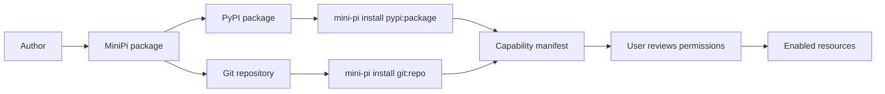

## 15. Revised Build Roadmap

| Phase | Goal             | Deliverables                                                     | Exit test                                           |
| ----- | ---------------- | ---------------------------------------------------------------- | --------------------------------------------------- |
| P0    | Core loop        | Python package, provider adapter, message types                  | One prompt returns a response                       |
| P1    | Tools            | `read`, `write`, `edit`, `bash` with Pydantic validation | Agent fixes one failing test                        |
| P2    | Safety           | Path policy, command policy, approvals, audit log                | Dangerous command is blocked or confirmed           |
| P3    | Sessions         | JSONL persistence, resume, branching                             | Quit, restart, continue; fork an approach           |
| P4    | Context          | `AGENTS.md`, context budget, artifact store                    | Large test log does not overflow context            |
| P5    | Extensions       | Event bus, tool registration, permission gate                    | Custom tool and safety extension work               |
| P6    | Skills/templates | Skill loader, slash templates, progressive disclosure            | `/review` and `/skill:release` work             |
| P7    | Compaction       | Summary + recent-window compaction                               | Long session remains usable                         |
| P8    | Evaluation       | Task suite, trace replay, regression report                      | A breaking change is detected automatically         |
| P9    | TUI              | Textual interface, streaming, diffs, status                      | Comfortable daily use                               |
| P10   | Packaging        | Install extensions/skills from Git or PyPI                       | Third-party package loads with reviewed permissions |

## 16. Final Architecture Checklist

- [ ] Four built-in tools only: `read`, `write`, `edit`, `bash`.
- [ ] All tool inputs validated with Pydantic.
- [ ] Every tool result is structured, bounded, and actionable.
- [ ] Large outputs become artifacts, not context bloat.
- [ ] Path and command policies run before execution.
- [ ] Dangerous actions require explicit approval.
- [ ] Every tool call and policy decision is auditable.
- [ ] Sessions are append-only JSONL with parent links.
- [ ] Branching preserves abandoned approaches.
- [ ] Crash recovery marks incomplete tool calls.
- [ ] Compaction preserves goals, edits, decisions, and blockers.
- [ ] Skills use progressive disclosure.
- [ ] Prompt templates become slash commands.
- [ ] Extensions declare capabilities and permissions.
- [ ] Model providers are isolated behind one adapter interface.
- [ ] Token and cost usage is visible per turn and session.
- [ ] Evaluation tasks run automatically on every core change.
- [ ] The TUI consumes events; it does not contain agent logic.
- [ ] Packages can be installed only after permission review.

## 17. The One-Sentence Product Rule

**MiniPi should not try to be a bigger agent; it should be a smaller, safer, more observable agent whose four tools, session tree, context system, and extension points are reliable enough to trust with real work.**

Pi’s own design supports this direction: a minimal terminal agent with configurable models, reusable resources, persistent branching sessions, print/JSON/RPC automation modes, and an SDK for embedding—while explicitly warning that tools and extensions run with the process’s permissions and are not sandboxed by project trust alone.
