# Build a Pi-Style Coding Agent in Python

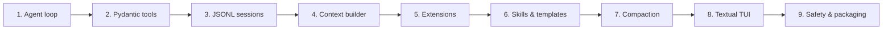

## 1. Project Setup

Use Python 3.11+ and `uv` or `pip`.

```bash
mkdir mini-pi
cd mini-pi

uv init
uv add pydantic pydantic-settings rich textual httpx
uv add anthropic openai
```

Recommended structure:

```text
mini-pi/
├── pyproject.toml
├── AGENTS.md
└── src/
    └── mini_pi/
        ├── __init__.py
        ├── cli.py
        ├── agent/
        │   ├── loop.py
        │   ├── context.py
        │   └── types.py
        ├── tools/
        │   ├── registry.py
        │   ├── read.py
        │   ├── write.py
        │   ├── edit.py
        │   └── bash.py
        ├── session/
        │   ├── store.py
        │   └── tree.py
        ├── providers/
        │   ├── base.py
        │   ├── anthropic_provider.py
        │   └── openai_provider.py
        ├── extensions/
        │   ├── api.py
        │   ├── runtime.py
        │   └── safety.py
        ├── skills/
        │   └── loader.py
        └── tui/
            └── app.py
```

## 2. Core Types

Model the conversation explicitly. Do not pass raw provider dictionaries throughout your codebase; normalize them into your own message format first.

```python
# src/mini_pi/agent/types.py
from __future__ import annotations

import time
import uuid
from typing import Any, Literal

from pydantic import BaseModel, Field


Role = Literal["system", "user", "assistant", "tool"]


class TextBlock(BaseModel):
    type: Literal["text"] = "text"
    text: str


class ToolUseBlock(BaseModel):
    type: Literal["tool_use"] = "tool_use"
    id: str
    name: str
    input: dict[str, Any]


class ToolResultBlock(BaseModel):
    type: Literal["tool_result"] = "tool_result"
    tool_use_id: str
    content: str
    is_error: bool = False


Block = TextBlock | ToolUseBlock | ToolResultBlock


class Message(BaseModel):
    id: str = Field(default_factory=lambda: str(uuid.uuid4()))
    role: Role
    content: list[Block]
    created_at: float = Field(default_factory=time.time)
    parent_id: str | None = None


class ToolCall(BaseModel):
    id: str
    name: str
    input: dict[str, Any]


class ToolResult(BaseModel):
    tool_call_id: str
    output: str
    is_error: bool = False
```

### Conversation flow

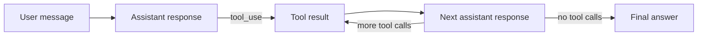

## 3. Tool Registry

Each tool needs four things:

1. A stable name.
2. A description for the model.
3. A Pydantic input model, which becomes JSON Schema.
4. An async executable function.

```python
# src/mini_pi/tools/registry.py
from __future__ import annotations

import abc
from dataclasses import dataclass
from pathlib import Path
from typing import Any, Awaitable, Callable

from pydantic import BaseModel


@dataclass(frozen=True)
class ToolContext:
    cwd: Path
    abort_event: Any | None = None


class Tool(abc.ABC, BaseModel):
    model_config = {"arbitrary_types_allowed": True}

    @property
    @abc.abstractmethod
    def name(self) -> str: ...

    @property
    @abc.abstractmethod
    def description(self) -> str: ...

    @abc.abstractmethod
    async def run(self, args: dict[str, Any], ctx: ToolContext) -> str: ...


class ToolRegistry:
    def __init__(self) -> None:
        self._tools: dict[str, Tool] = {}

    def register(self, tool: Tool) -> None:
        if tool.name in self._tools:
            raise ValueError(f"Duplicate tool name: {tool.name}")
        self._tools[tool.name] = tool

    def get(self, name: str) -> Tool:
        if name not in self._tools:
            raise KeyError(f"Unknown tool: {name}")
        return self._tools[name]

    def schemas(self) -> list[dict[str, Any]]:
        return [
            {
                "name": tool.name,
                "description": tool.description,
                "input_schema": tool.model_json_schema(),
            }
            for tool in self._tools.values()
        ]

    async def execute(
        self, name: str, arguments: dict[str, Any], ctx: ToolContext
    ) -> str:
        tool = self.get(name)
        return await tool.run(arguments, ctx)
```

A cleaner production design uses a generic `Tool[InputModel]` class and validates arguments with `InputModel.model_validate(arguments)`. Pydantic then produces the JSON Schema automatically.

## 4. Built-in Tools

Start with Pi’s minimal core: `read`, `write`, `edit`, and `bash`.

### `read`

```python
# src/mini_pi/tools/read.py
from __future__ import annotations

from pathlib import Path
from typing import Any

from pydantic import BaseModel, Field

from .registry import Tool, ToolContext


class ReadArgs(BaseModel):
    path: str = Field(description="File path, relative to the project root")


class ReadTool(Tool):
    @property
    def name(self) -> str:
        return "read"

    @property
    def description(self) -> str:
        return (
            "Read a UTF-8 text file. Returns numbered lines so later edits "
            "can reference exact text."
        )

    def args_model(self) -> type[BaseModel]:
        return ReadArgs

    async def run(self, args: dict[str, Any], ctx: ToolContext) -> str:
        data = ReadArgs.model_validate(args)
        path = (ctx.cwd / data.path).resolve()

        if not path.is_file():
            raise FileNotFoundError(f"No such file: {path}")

        text = path.read_text(encoding="utf-8")

        return "\n".join(
            f"{number:5d} | {line}"
            for number, line in enumerate(text.splitlines(), start=1)
        )
```

### `write`

```python
# src/mini_pi/tools/write.py
from __future__ import annotations

from pathlib import Path
from typing import Any

from pydantic import BaseModel, Field

from .registry import Tool, ToolContext


class WriteArgs(BaseModel):
    path: str
    content: str


class WriteTool(Tool):
    @property
    def name(self) -> str:
        return "write"

    @property
    def description(self) -> str:
        return "Create a new file or completely replace an existing file."

    def args_model(self) -> type[BaseModel]:
        return WriteArgs

    async def run(self, args: dict[str, Any], ctx: ToolContext) -> str:
        data = WriteArgs.model_validate(args)
        path = (ctx.cwd / data.path).resolve()
        path.parent.mkdir(parents=True, exist_ok=True)
        path.write_text(data.content, encoding="utf-8")
        return f"Wrote {data.path}"
```

### `edit`

Use exact-text replacement. Require the `old_text` to occur exactly once; this avoids ambiguous or destructive fuzzy patches.

```python
# src/mini_pi/tools/edit.py
from __future__ import annotations

from pathlib import Path
from typing import Any

from pydantic import BaseModel, Field

from .registry import Tool, ToolContext


class EditArgs(BaseModel):
    path: str
    old_text: str = Field(min_length=1)
    new_text: str


class EditTool(Tool):
    @property
    def name(self) -> str:
        return "edit"

    @property
    def description(self) -> str:
        return (
            "Replace an exact, unique block of text in an existing file. "
            "old_text must match exactly."
        )

    def args_model(self) -> type[BaseModel]:
        return EditArgs

    async def run(self, args: dict[str, Any], ctx: ToolContext) -> str:
        data = EditArgs.model_validate(args)
        path = (ctx.cwd / data.path).resolve()

        if not path.is_file():
            raise FileNotFoundError(f"No such file: {path}")

        original = path.read_text(encoding="utf-8")
        occurrences = original.count(data.old_text)

        if occurrences == 0:
            raise ValueError("old_text not found")
        if occurrences > 1:
            raise ValueError(
                f"old_text matched {occurrences} times; include more surrounding context"
            )

        updated = original.replace(data.old_text, data.new_text, 1)
        path.write_text(updated, encoding="utf-8")

        return f"Edited {data.path}"
```

### `bash`

```python
# src/mini_pi/tools/bash.py
from __future__ import annotations

import asyncio
import shlex
from typing import Any

from pydantic import BaseModel, Field

from .registry import Tool, ToolContext


class BashArgs(BaseModel):
    command: str
    timeout_seconds: float = Field(default=60, gt=0, le=600)


class BashTool(Tool):
    @property
    def name(self) -> str:
        return "bash"

    @property
    def description(self) -> str:
        return (
            "Run a shell command in the project directory. "
            "Returns stdout, stderr, and exit code."
        )

    def args_model(self) -> type[BaseModel]:
        return BashArgs

    async def run(self, args: dict[str, Any], ctx: ToolContext) -> str:
        data = BashArgs.model_validate(args)

        try:
            process = await asyncio.create_subprocess_shell(
                data.command,
                cwd=ctx.cwd,
                stdout=asyncio.subprocess.PIPE,
                stderr=asyncio.subprocess.PIPE,
            )

            stdout, stderr = await asyncio.wait_for(
                process.communicate(),
                timeout=data.timeout_seconds,
            )
        except asyncio.TimeoutError:
            return "Command timed out."

        output = (
            f"Exit code: {process.returncode}\n"
            f"STDOUT:\n{stdout.decode(errors='replace')}\n"
            f"STDERR:\n{stderr.decode(errors='replace')}"
        )

        return truncate(output, limit=20_000)


def truncate(text: str, limit: int = 20_000) -> str:
    if len(text) <= limit:
        return text
    return text[:limit] + "\n...[output truncated]"
```

### Tool decision flow

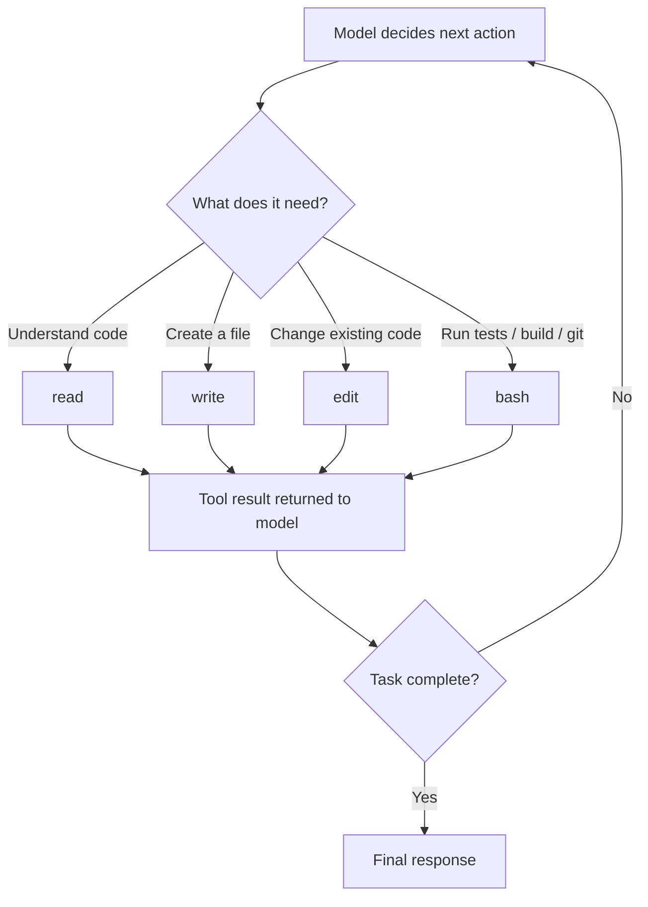

## 5. Provider Adapter

Keep all provider differences behind one abstract interface.

```python
# src/mini_pi/providers/base.py
from __future__ import annotations

import abc
from dataclasses import dataclass
from typing import Any

from mini_pi.agent.types import Message


@dataclass(frozen=True)
class CompletionRequest:
    system: str
    messages: list[Message]
    tools: list[dict[str, Any]]


@dataclass(frozen=True)
class CompletionResponse:
    message: Message
    input_tokens: int = 0
    output_tokens: int = 0


class ModelClient(abc.ABC):
    model_id: str

    @abc.abstractmethod
    async def complete(self, request: CompletionRequest) -> CompletionResponse: ...
```

### Anthropic adapter sketch

```python
# src/mini_pi/providers/anthropic_provider.py
from __future__ import annotations

import os
import uuid

import anthropic

from mini_pi.agent.types import (
    Message,
    TextBlock,
    ToolResultBlock,
    ToolUseBlock,
)
from .base import CompletionRequest, CompletionResponse, ModelClient


class AnthropicClient(ModelClient):
    model_id = "claude-sonnet-4-5"

    def __init__(self) -> None:
        self.client = anthropic.AsyncAnthropic(
            api_key=os.environ["ANTHROPIC_API_KEY"]
        )

    async def complete(self, request: CompletionRequest) -> CompletionResponse:
        messages = self._to_anthropic_messages(request.messages)

        response = await self.client.messages.create(
            model=self.model_id,
            max_tokens=8192,
            system=request.system,
            messages=messages,
            tools=[
                {
                    "name": tool["name"],
                    "description": tool["description"],
                    "input_schema": tool["input_schema"],
                }
                for tool in request.tools
            ],
        )

        blocks: list[TextBlock | ToolUseBlock] = []

        for block in response.content:
            if block.type == "text":
                blocks.append(TextBlock(text=block.text))
            elif block.type == "tool_use":
                blocks.append(
                    ToolUseBlock(
                        id=block.id,
                        name=block.name,
                        input=dict(block.input),
                    )
                )

        message = Message(
            id=str(uuid.uuid4()),
            role="assistant",
            content=blocks,
        )

        return CompletionResponse(
            message=message,
            input_tokens=response.usage.input_tokens,
            output_tokens=response.usage.output_tokens,
        )

    def _to_anthropic_messages(self, messages: list[Message]) -> list[dict]:
        converted: list[dict] = []

        for message in messages:
            if message.role == "user":
                converted.append(
                    {
                        "role": "user",
                        "content": [
                            {"type": "text", "text": block.text}
                            for block in message.content
                            if isinstance(block, TextBlock)
                        ],
                    }
                )

            elif message.role == "assistant":
                converted.append(
                    {
                        "role": "assistant",
                        "content": [
                            block.model_dump()
                            for block in message.content
                            if isinstance(block, (TextBlock, ToolUseBlock))
                        ],
                    }
                )

            elif message.role == "tool":
                converted.append(
                    {
                        "role": "user",
                        "content": [
                            {
                                "type": "tool_result",
                                "tool_use_id": block.tool_use_id,
                                "content": block.content,
                                "is_error": block.is_error,
                            }
                            for block in message.content
                            if isinstance(block, ToolResultBlock)
                        ],
                    }
                )

        return converted
```

Anthropic’s Python SDK supports tool use, and its tool helpers can derive schemas from Python function signatures and docstrings. [platform.claude](https://platform.claude.com/docs/en/cli-sdks-libraries/sdks/python)

## 6. The Agent Loop

This is the heart of the system.

```python
# src/mini_pi/agent/loop.py
from __future__ import annotations

import uuid
from dataclasses import dataclass
from typing import Callable

from mini_pi.agent.types import (
    Message,
    TextBlock,
    ToolCall,
    ToolResultBlock,
    ToolUseBlock,
)
from mini_pi.providers.base import ModelClient
from mini_pi.tools.registry import ToolContext, ToolRegistry


@dataclass
class AgentConfig:
    system_prompt: str
    max_turns: int = 40


class AgentLoop:
    def __init__(
        self,
        model: ModelClient,
        tools: ToolRegistry,
        config: AgentConfig,
        cwd: str = ".",
        on_event: Callable[[dict], None] | None = None,
    ) -> None:
        self.model = model
        self.tools = tools
        self.config = config
        self.cwd = cwd
        self.on_event = on_event or (lambda event: None)

    async def run(
        self, history: list[Message], user_text: str
    ) -> list[Message]:
        user_message = Message(
            id=str(uuid.uuid4()),
            role="user",
            content=[TextBlock(text=user_text)],
        )

        history.append(user_message)
        self._emit("agent_start", {"user_message_id": user_message.id})

        for turn in range(self.config.max_turns):
            self._emit("turn_start", {"turn": turn + 1})

            response = await self.model.complete(
                request=type("Request", (), {})(
                    system=self.config.system_prompt,
                    messages=history,
                    tools=self.tools.schemas(),
                )
            )

            assistant_message = response.message
            history.append(assistant_message)
            self._emit("message_end", {"message": assistant_message.model_dump()})

            tool_calls = [
                block
                for block in assistant_message.content
                if isinstance(block, ToolUseBlock)
            ]

            if not tool_calls:
                self._emit("agent_end", {"reason": "final_response"})
                return history

            for call in tool_calls:
                result = await self._execute_tool(call)
                history.append(result)
                self._emit("tool_result", {"result": result.model_dump()})

        raise RuntimeError("Agent exceeded maximum turns")

    async def _execute_tool(self, call: ToolUseBlock) -> Message:
        ctx = ToolContext(cwd=self.cwd)

        try:
            self._emit(
                "tool_execution_start",
                {"tool": call.name, "input": call.input},
            )

            output = await self.tools.execute(call.name, call.input, ctx)
            is_error = False
        except Exception as error:
            output = f"Tool error: {type(error).__name__}: {error}"
            is_error = True

        self._emit(
            "tool_execution_end",
            {"tool": call.name, "is_error": is_error},
        )

        return Message(
            id=str(uuid.uuid4()),
            role="tool",
            content=[
                ToolResultBlock(
                    tool_use_id=call.id,
                    content=output,
                    is_error=is_error,
                )
            ],
        )

    def _emit(self, event_type: str, payload: dict) -> None:
        self.on_event({"type": event_type, **payload})
```

### Agent-loop state machine

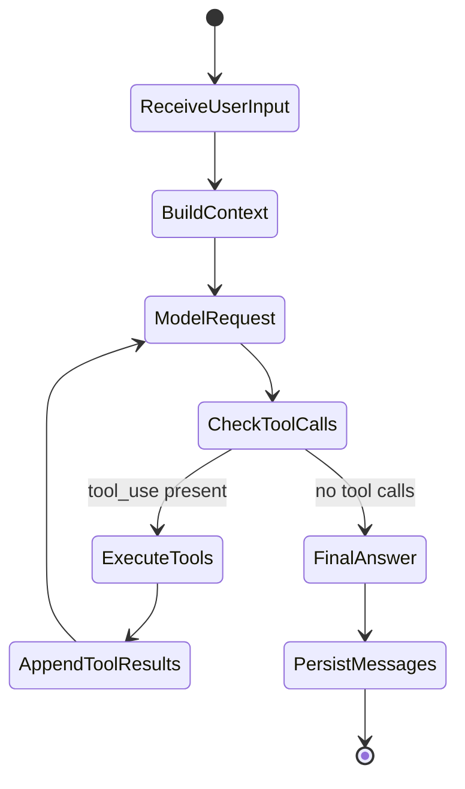

## 7. Session Persistence

Use JSON Lines for durability. Each message is one JSON object per line.

```python
# src/mini_pi/session/store.py
from __future__ import annotations

import json
from pathlib import Path

from mini_pi.agent.types import Message


class JsonlSessionStore:
    def __init__(self, path: Path) -> None:
        self.path = path
        self.path.parent.mkdir(parents=True, exist_ok=True)

    def append(self, message: Message) -> None:
        with self.path.open("a", encoding="utf-8") as file:
            file.write(message.model_dump_json() + "\n")

    def load(self) -> list[Message]:
        if not self.path.exists():
            return []

        messages: list[Message] = []

        for line in self.path.read_text(encoding="utf-8").splitlines():
            if line.strip():
                messages.append(Message.model_validate_json(line))

        return messages
```

### Branching session tree

Store a parent ID on every message. The active leaf determines which branch is reconstructed.

```python
# src/mini_pi/session/tree.py
from __future__ import annotations

from mini_pi.agent.types import Message


class SessionTree:
    def __init__(self) -> None:
        self.messages: dict[str, Message] = {}
        self.active_leaf_id: str | None = None

    def append(self, message: Message) -> Message:
        message.parent_id = self.active_leaf_id
        self.messages[message.id] = message
        self.active_leaf_id = message.id
        return message

    def switch_to(self, message_id: str) -> None:
        if message_id not in self.messages:
            raise KeyError(f"Unknown message: {message_id}")
        self.active_leaf_id = message_id

    def active_path(self) -> list[Message]:
        path: list[Message] = []
        cursor = self.active_leaf_id

        while cursor:
            message = self.messages[cursor]
            path.append(message)
            cursor = message.parent_id

        return list(reversed(path))
```

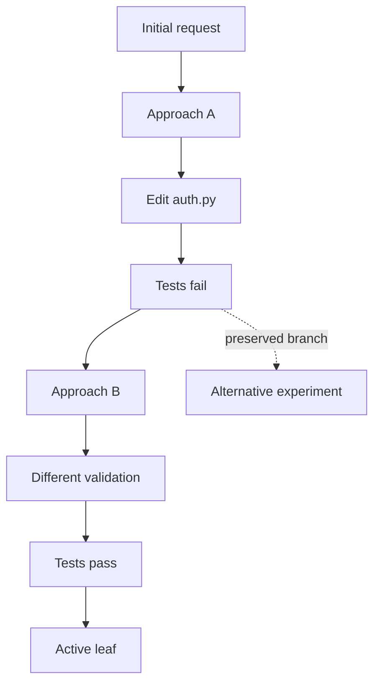

## 8. Context Builder

Pi keeps the base prompt small and layers project-specific instructions on top. Your Python version should do the same.

```python
# src/mini_pi/agent/context.py
from __future__ import annotations

from pathlib import Path

BASE_SYSTEM_PROMPT = """\
You are a careful terminal coding agent.

Rules:
1. Read relevant files before editing them.
2. Make the smallest change that solves the task.
3. Use edit for existing files and write only for new files.
4. Run tests or relevant commands after meaningful changes.
5. Explain what changed and how you verified it.
6. Never invent file contents; inspect the repository first.
7. Ask before destructive or irreversible operations.
"""


def load_context_files(cwd: Path) -> str:
    parts: list[str] = []

    global_agents = Path.home() / ".mini-pi" / "AGENTS.md"
    project_agents = cwd / "AGENTS.md"

    for path in (global_agents, project_agents):
        if path.exists():
            text = path.read_text(encoding="utf-8")
            parts.append(f"# Context file: {path}\n\n{text}")

    return "\n\n".join(parts)


def build_system_prompt(cwd: Path) -> str:
    return f"{BASE_SYSTEM_PROMPT}\n\n{load_context_files(cwd)}"
```

### Prompt layering

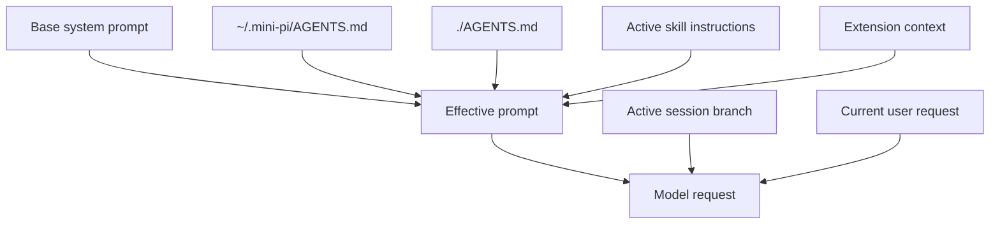

## 9. Extensions in Python

Extensions should be ordinary Python modules with a `register(pi)` entry point.

```python
# src/mini_pi/extensions/api.py
from __future__ import annotations

import abc
from dataclasses import dataclass
from typing import Any, Awaitable, Callable

from mini_pi.tools.registry import Tool


@dataclass
class ExtensionContext:
    cwd: str

    async def confirm(self, title: str, message: str) -> bool:
        answer = input(f"{title}\n{message}\nAllow? [y/N] ")
        return answer.strip().lower() in {"y", "yes"}


class ExtensionAPI:
    def __init__(self) -> None:
        self.handlers: dict[str, list[Callable]] = {}
        self.tools: list[Tool] = []
        self.commands: dict[str, Callable] = {}

    def on(self, event: str, handler: Callable) -> None:
        self.handlers.setdefault(event, []).append(handler)

    def register_tool(self, tool: Tool) -> None:
        self.tools.append(tool)

    def register_command(self, name: str, handler: Callable) -> None:
        self.commands[name] = handler

    async def emit(self, event: str, payload: dict[str, Any]) -> Any:
        result = None

        for handler in self.handlers.get(event, []):
            result = await handler(payload, ExtensionContext(cwd="."))

        return result
```

### Permission gate

```python
# src/mini_pi/extensions/safety.py
from __future__ import annotations

from mini_pi.extensions.api import ExtensionAPI, ExtensionContext

DANGEROUS_PATTERNS = (
    "rm -rf",
    "sudo ",
    "git push --force",
    "git reset --hard",
    "chmod -R 777",
)


async def register(pi: ExtensionAPI) -> None:
    async def gate(payload: dict, ctx: ExtensionContext):
        if payload.get("tool") != "bash":
            return None

        command = payload.get("input", {}).get("command", "")

        if not any(pattern in command for pattern in DANGEROUS_PATTERNS):
            return None

        allowed = await ctx.confirm(
            "Dangerous command",
            f"Allow this command?\n\n{command}",
        )

        if not allowed:
            return {"block": True, "reason": "Blocked by safety extension"}

        return None

    pi.on("tool_call", gate)
```

### Extension lifecycle

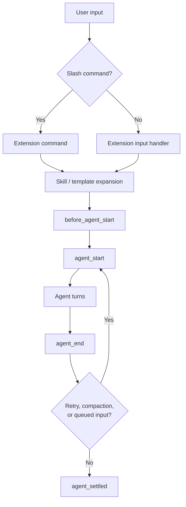

## 10. Skills and Prompt Templates

Create a skill directory:

```text
~/.mini-pi/skills/release/
├── SKILL.md
└── scripts/
    └── check_release.sh
```

`SKILL.md`:

```markdown
# Release skill

## Goal
Prepare and verify a production release.

## Procedure
1. Run the full test suite.
2. Run lint and type checks.
3. Build the package.
4. Update CHANGELOG.md.
5. Ask before creating a Git tag.
6. Summarize the release.

## Approval gates
- Ask before tagging.
- Ask before pushing to a remote.
```

Loader:

```python
# src/mini_pi/skills/loader.py
from __future__ import annotations

from pathlib import Path

SKILLS_DIR = Path.home() / ".mini-pi" / "skills"


def list_skills() -> dict[str, str]:
    skills: dict[str, str] = {}

    if not SKILLS_DIR.exists():
        return skills

    for skill_dir in SKILLS_DIR.iterdir():
        skill_file = skill_dir / "SKILL.md"

        if skill_file.exists():
            skills[skill_dir.name] = skill_file.read_text(encoding="utf-8")

    return skills


def load_skill(name: str) -> str:
    skills = list_skills()

    if name not in skills:
        raise KeyError(f"Unknown skill: {name}")

    return skills[name]
```

### Progressive disclosure

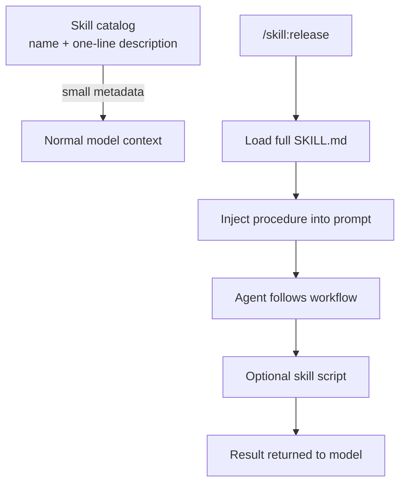

## 11. Prompt Templates

Store Markdown templates in `~/.mini-pi/prompts/`. Each filename becomes a slash command.

```text
~/.mini-pi/prompts/
├── review.md
├── debug.md
└── refactor.md
```

`review.md`:

```markdown
Review the current working-tree changes.

Focus on:
1. Correctness and edge cases
2. Security and input validation
3. Error handling
4. Test coverage
5. Readability

Return:
- Critical issues
- Important issues
- Optional improvements
- Recommended next action
```

```python
# src/mini_pi/skills/templates.py
from pathlib import Path

PROMPTS_DIR = Path.home() / ".mini-pi" / "prompts"


def load_template(name: str) -> str:
    path = PROMPTS_DIR / f"{name}.md"

    if not path.exists():
        raise FileNotFoundError(f"Unknown template: /{name}")

    return path.read_text(encoding="utf-8")
```

## 12. Compaction

Compaction prevents a useful long session from becoming unusable. Summarize old history, preserve the active goal and decisions, and keep recent turns verbatim.

```python
# src/mini_pi/session/compact.py
from __future__ import annotations

from collections.abc import Awaitable, Callable

from mini_pi.agent.types import Message


async def compact_history(
    history: list[Message],
    summarize: Callable[[list[Message]], Awaitable[str]],
    keep_recent: int = 10,
) -> tuple[Message, list[Message]]:
    old = history[:-keep_recent]
    recent = history[-keep_recent:]

    summary_text = await summarize(old)

    summary = Message(
        role="user",
        content=[
            {
                "type": "text",
                "text": (
                    "Earlier session summary:\n\n"
                    f"{summary_text}\n\n"
                    "Continue from the most recent messages below."
                ),
            }
        ],
    )

    return summary, recent
```

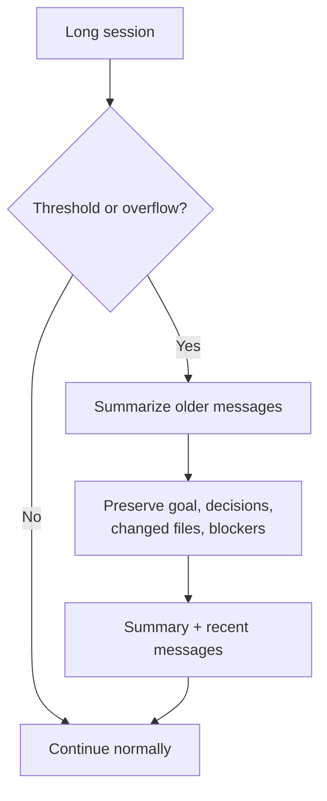

## 13. Terminal UI

For Python, use **Textual** for a real TUI or start with `rich` for a simpler streaming console.

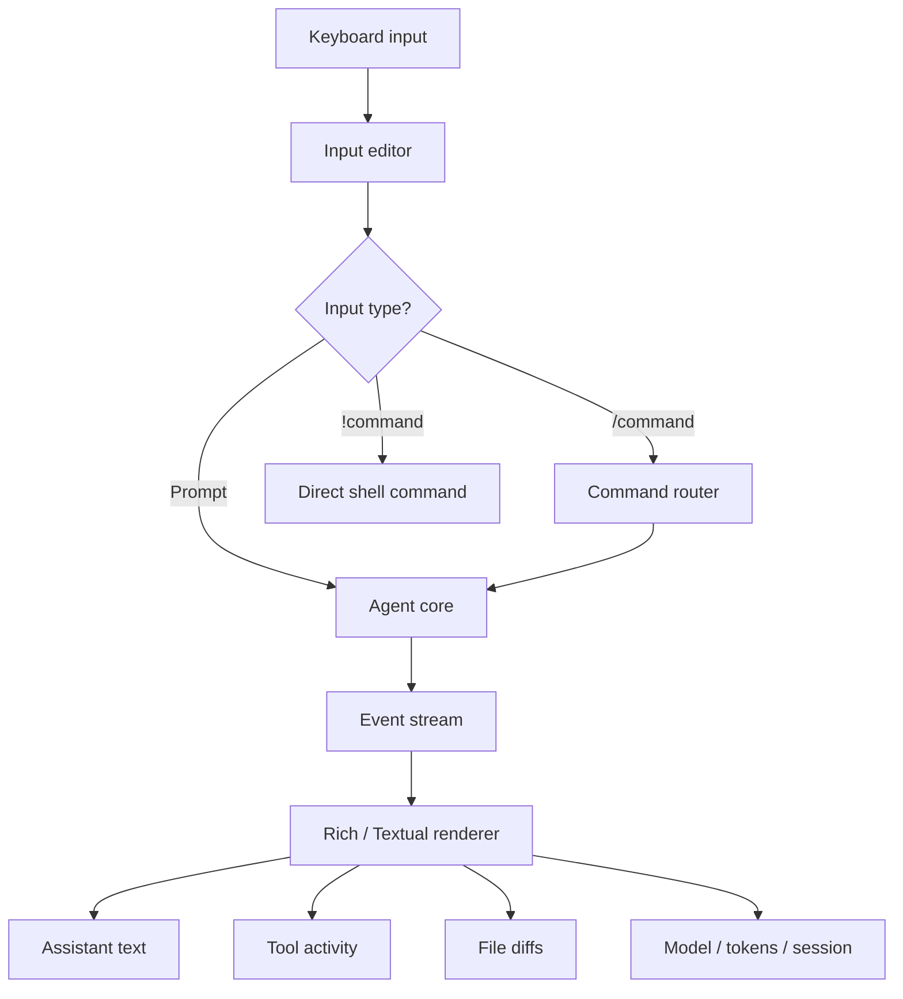

Minimal event-driven console:

```python
# src/mini_pi/tui/console.py
from rich.console import Console

console = Console()


def render_event(event: dict) -> None:
    kind = event["type"]

    if kind == "message_update":
        console.print(event["delta"], end="")

    elif kind == "tool_execution_start":
        console.print(f"\n[bold cyan]▸ {event['tool']}[/bold cyan]")

    elif kind == "tool_execution_end":
        style = "red" if event["is_error"] else "green"
        symbol = "✗" if event["is_error"] else "✓"
        console.print(f"[{style}]{symbol} {event['tool']} completed[/{style}]")

    elif kind == "agent_settled":
        console.print("\n[bold green]● ready[/bold green]")
```

## 14. CLI Entry Point

```python
# src/mini_pi/cli.py
from __future__ import annotations

import asyncio
import sys
from pathlib import Path

from mini_pi.agent.context import build_system_prompt
from mini_pi.agent.loop import AgentConfig, AgentLoop
from mini_pi.providers.anthropic_provider import AnthropicClient
from mini_pi.session.store import JsonlSessionStore
from mini_pi.tools.bash import BashTool
from mini_pi.tools.edit import EditTool
from mini_pi.tools.read import ReadTool
from mini_pi.tools.registry import ToolRegistry
from mini_pi.tools.write import WriteTool
from mini_pi.tui.console import render_event


async def main() -> None:
    cwd = Path.cwd()

    registry = ToolRegistry()
    registry.register(ReadTool())
    registry.register(WriteTool())
    registry.register(EditTool())
    registry.register(BashTool())

    store = JsonlSessionStore(cwd / ".mini-pi" / "session.jsonl")
    history = store.load()

    agent = AgentLoop(
        model=AnthropicClient(),
        tools=registry,
        config=AgentConfig(system_prompt=build_system_prompt(cwd)),
        cwd=str(cwd),
        on_event=render_event,
    )

    user_text = " ".join(sys.argv[1:]) or "Explain this repository."

    result = await agent.run(history, user_text)

    for message in result:
        store.append(message)

    final_blocks = [
        block.text
        for block in result[-1].content
        if block.type == "text"
    ]

    print("\n" + "\n".join(final_blocks))


if __name__ == "__main__":
    asyncio.run(main())
```

Run:

```bash
uv run python -m mini_pi.cli "Read README.md and summarize this project."
```

## 15. Safety Pipeline

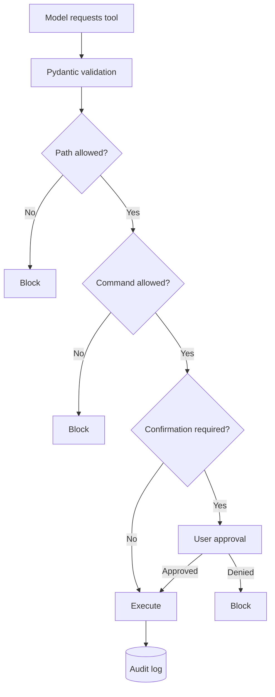

Implement these guardrails early:

- Validate all tool arguments with Pydantic.
- Resolve paths and prevent escapes outside the workspace.
- Deny writes to `.env`, `.git/`, `node_modules/`, and credential paths.
- Require approval for `rm -rf`, `sudo`, force pushes, and hard resets.
- Add timeouts and output truncation to shell commands.
- Log every tool call, input, result, and approval decision.
- Treat third-party extensions as executable code and review them before loading.

## 16. Build Order

| Milestone | Python deliverable                      | Verification                               |
| --------- | --------------------------------------- | ------------------------------------------ |
| M1        | `ModelClient` + chat loop             | Ask a question and receive a response      |
| M2        | `ToolRegistry`                        | Model calls one tool and uses its result   |
| M3        | `read`, `write`, `edit`, `bash` | Agent fixes a small bug and runs tests     |
| M4        | JSONL persistence                       | Restart and resume the session             |
| M5        | Session tree                            | Fork an alternative approach               |
| M6        | `AGENTS.md` loader                    | Agent follows repo conventions             |
| M7        | Extension runtime                       | Add a custom tool and safety gate          |
| M8        | Skills and templates                    | `/review` and `/skill:release` work    |
| M9        | Compaction                              | Long session stays within context limits   |
| M10       | Rich/Textual TUI                        | Streaming, tool views, diffs, status       |
| M11       | Multi-provider support                  | Switch Anthropic and OpenAI models         |
| M12       | Packaging                               | Install an extension pack from Git or PyPI |

## 17. Python-Specific Choices

| Concern       | Recommended choice              | Why                                            |
| ------------- | ------------------------------- | ---------------------------------------------- |
| Tool schemas  | Pydantic v2                     | Automatic JSON Schema and validation           |
| Async runtime | `asyncio`                     | Natural fit for streaming and subprocesses     |
| Terminal UI   | Textual                         | Full TUI framework in Python                   |
| Pretty output | Rich                            | Streaming, syntax highlighting, panels, tables |
| HTTP          | `httpx`                       | Async-friendly provider and webhook calls      |
| Config        | `pydantic-settings`           | Environment variables and typed settings       |
| Tests         | `pytest` + `pytest-asyncio` | Test tools, loop, and extensions               |
| Packaging     | `uv` + `pyproject.toml`     | Modern, fast Python project workflow           |

OpenAI-compatible tool definitions use a JSON Schema `parameters` object, and the application executes the function and returns its output for the next model request.  Anthropic’s Python SDK likewise supports tool use and can derive tool schemas from Python function signatures and docstrings. [platform.openai](https://platform.openai.com/docs/guides/function-calling)

## 18. First Working Goal

Your first milestone should be deliberately narrow:

> Build a Python CLI where a user types a task, an LLM can call `read`, `edit`, and `bash`, and the agent can fix one failing test in a small repository.

Once that works, add persistence, then branching, then extensions, then skills, then compaction, and finally the polished TUI. This ordering prevents you from building a beautiful interface around an agent that cannot yet reliably act.
